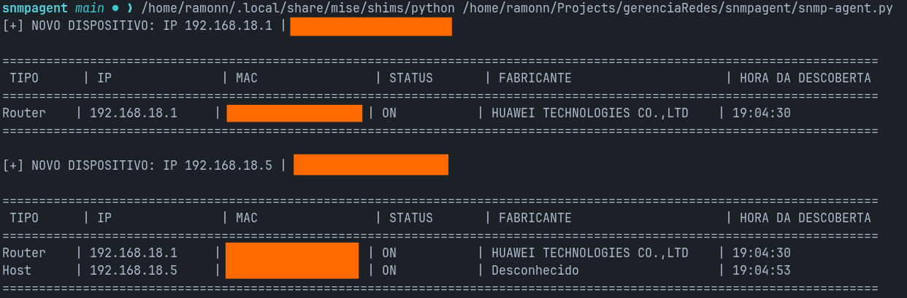
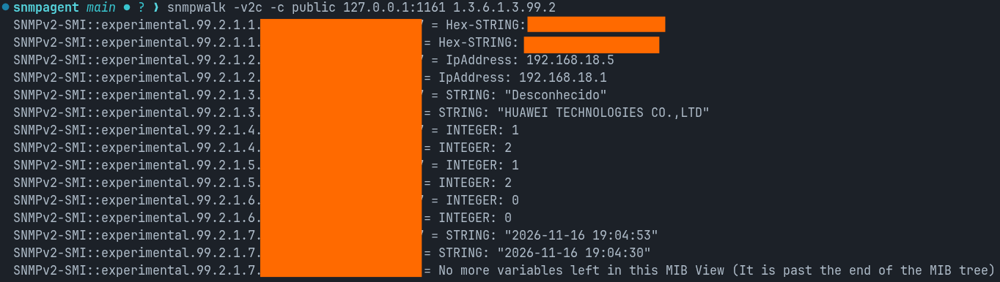
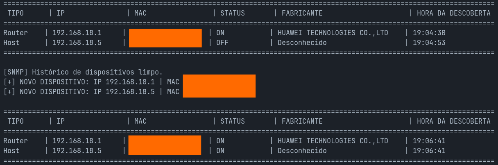

# SNMP Scanner

Agente SNMP em Python que faz varreduras ARP na rede local e disponibiliza os dispositivos encontrados por meio da MIB `SNMP-SCANNER-MIB`.

## Instalação

Instale as dependências:

pip install pysnmp==7.1.32 pysnmp-pysmi==6.0.1 scapy

## Preparar a MIB

Na raiz do projeto:

mibdump --mib-source="file://$(realpath ./mibs)" \
  --destination-format=pysnmp \
  --destination-directory="$HOME/.pysnmp/mibs" \
  --rebuild SNMP-SCANNER-MIB

## Executar

Configure a rede em `snmp-agent.py` e execute:

python snmp-agent.py

O agente utiliza 127.0.0.1:1161 e comunidade public.

## Consultar

Consultar sub-rede e quantidade de dispositivos:

snmpget -v2c -c public 127.0.0.1:1161 1.3.6.1.3.99.1.2.0

snmpget -v2c -c public 127.0.0.1:1161 1.3.6.1.3.99.1.4.0

Listar dispositivos:

snmpwalk -v2c -c public 127.0.0.1:1161 1.3.6.1.3.99.2

Limpar histórico:

snmpset -v2c -c public 127.0.0.1:1161 1.3.6.1.3.99.1.5.0 i 1

